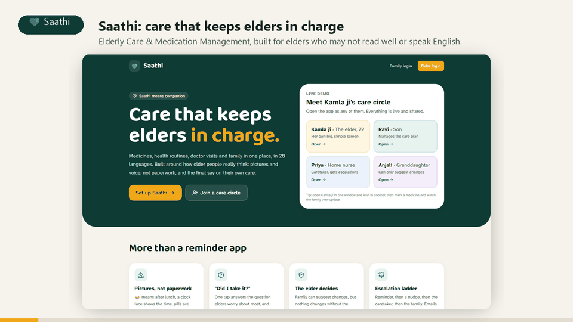
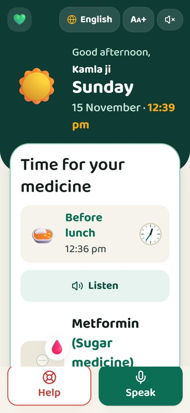
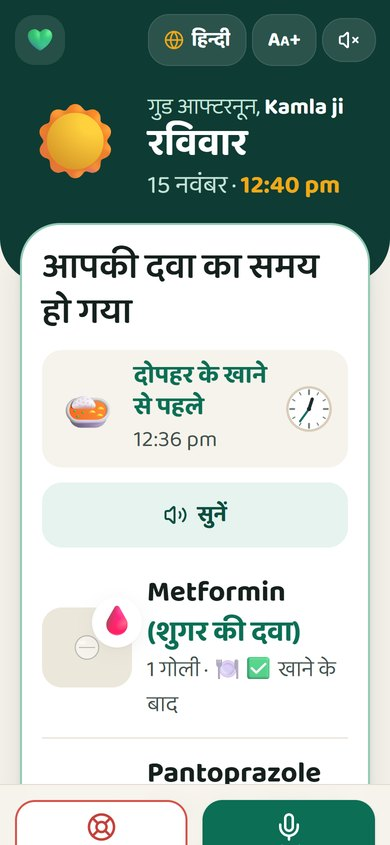
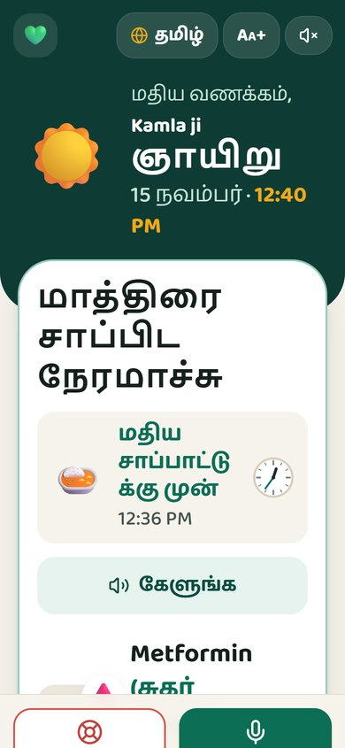
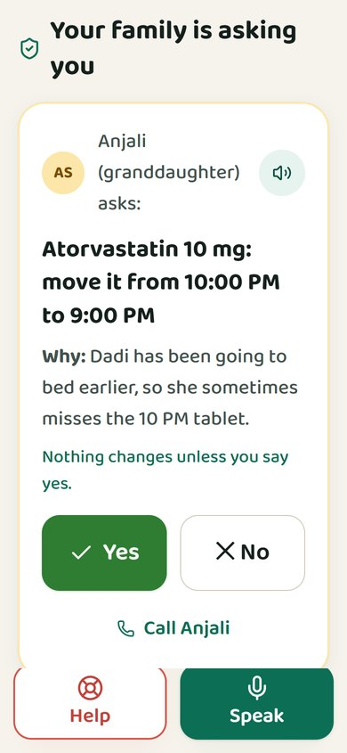
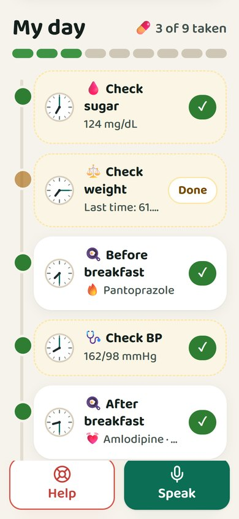
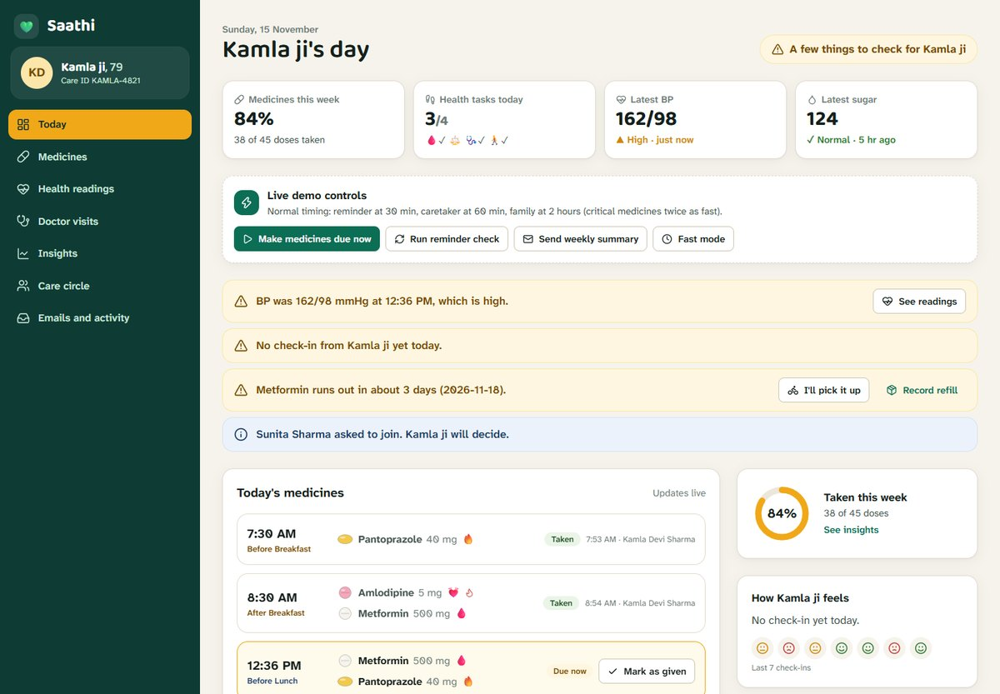
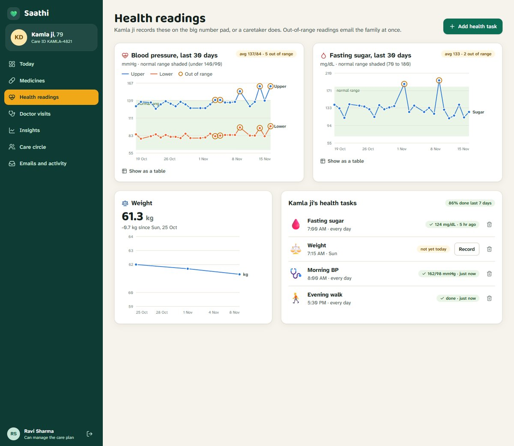
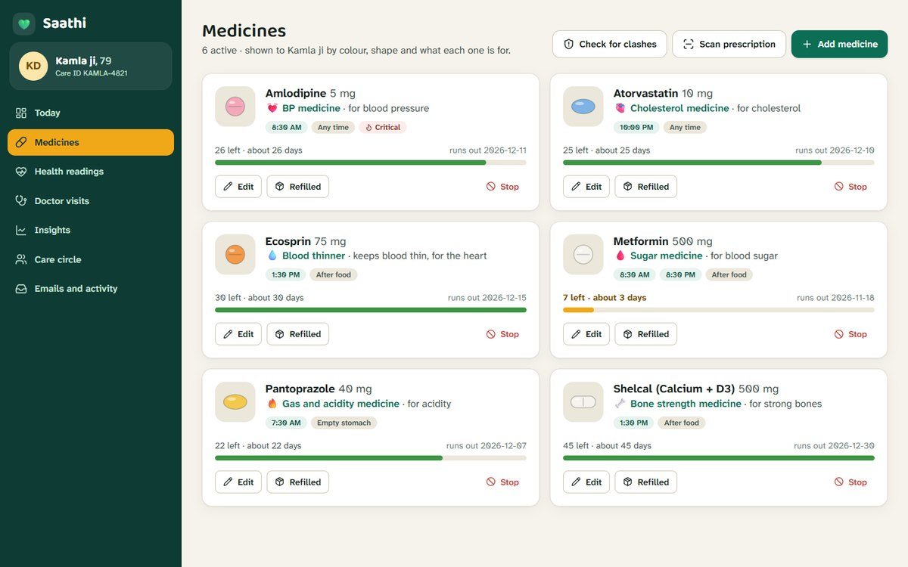
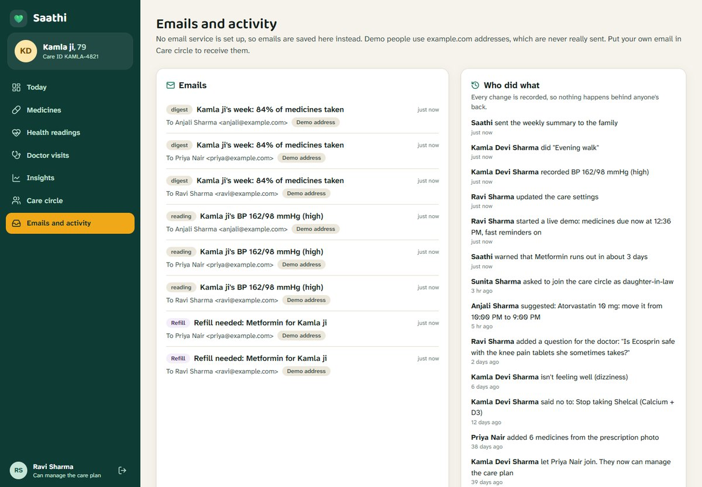

# Saathi: care that keeps elders in charge

**A medication and care platform for elderly people, their families and their caretakers, designed for elders who may not read English or use smartphones confidently.**

Built by **Akshat Dalakoti** for **CATALYST: Solo AI Hackathon**, organised by **Makers Need More (MnM)** in collaboration with **PromptWars**.
Problem statement: *Elderly Care & Medication Management Platform*.

| | |
|---|---|
| 🌐 **Live demo** | https://saathi-d7zs.onrender.com |
| 🎬 **Demo video** | [Watch below](#demo) · [download the MP4](docs/saathi-demo.mp4) |

> The live demo runs on Render's free plan. If nobody has opened it for 15 minutes it sleeps, so the **first load can take about 50 seconds**. After that it's instant.

---

## Demo



### Try it yourself in one click

No sign-up needed. Each link logs you in as a member of the demo family, **Kamla ji (79)** and her care circle:

| Open as | Who they are | Link |
|---|---|---|
| **Kamla ji** | The elder: her own big, simple screen | https://saathi-d7zs.onrender.com/demo/elder |
| **Ravi** | Her son, manages the care plan | https://saathi-d7zs.onrender.com/demo/ravi |
| **Priya** | Home nurse (caretaker), gets escalations first | https://saathi-d7zs.onrender.com/demo/priya |
| **Anjali** | Granddaughter, can only *suggest* changes | https://saathi-d7zs.onrender.com/demo/anjali |

Manual logins: elder Care ID `KAMLA-4821` with PIN `1234`. Family: `ravi@example.com` / `1111`, `priya@example.com` / `2222`, `anjali@example.com` / `3333`, and `sunita@example.com` / `4444`, who is still waiting for Kamla ji's approval. The circle passcode is `246810`.

---

## The problem

Millions of elderly people take five or more medicines a day. Most medicine apps assume you read English well, think in clock times and are comfortable with smartphones. Many elders, especially in India, aren't. The result is missed doses, double doses ("did I already take it?"), worried families, and care decisions made *about* elders instead of *with* them.

## The solution

Saathi ("companion") is built around **how older people actually think**, and it keeps **the elder in charge** of their own care.

| Elderly people think… | So Saathi… |
|---|---|
| "I can't read this well" | puts pictures first: 🍛 for "after lunch", a clock face with hands, pills drawn the way they look (repeated for "2 tablets"), 🍽️✅ for "after food", big emoji tiles, and a full-screen ✔ when a dose is done |
| "I can't say *Atorvastatin*" | writes what every medicine is for in brackets, in their language, with a picture: **Metformin (शुगर की दवा)**, **Atorvastatin (🫀 cholesterol medicine)**. Voice reads out "sugar medicine", never the hard name |
| "English isn't my language" | runs the elder's screen in **20 languages**, each shown in its own script in the picker. Urdu and Arabic read right to left |
| "I'd rather listen than read" | reads everything aloud and understands spoken commands in all 20 languages |
| in routines ("after lunch"), not clock times | labels every dose by the elder's own daily routine |
| "Did I already take it?" | answers in one tap, or by voice, and warns against a double dose |
| "I'm not sure" | lets them say exactly that, instead of guessing, and asks the family to check |
| "It's my body, my decision" | turns family edits into **proposals the elder approves**, lets the elder decide who joins and what each person may do, and logs every change |
| "I don't want to be a bother" | has one Help button that tells everyone, a silent alarm if there's no sign of them by 11 AM, and "I'm okay" in one tap |
| "I forget what to ask the doctor" | keeps a question list (typed or spoken) that prints first on the doctor visit sheet |

---

## Features

### What the problem statement asks for, and how Saathi delivers it

| Requirement | In Saathi |
|---|---|
| Shared ecosystem for elders, caretakers and family | A care circle per elder with three roles: elder (owner), caretaker and family. Each person gets their own login and view |
| Secure, passcode-based access | A Care ID plus a 6-digit circle passcode to ask to join, and **the elder approves each person**. Personal PINs are hashed with scrypt. Five wrong PINs lock the login for 5 minutes. Sessions use httpOnly cookies |
| View, add, edit and manage medication schedules | Full medicine management: routine-based times, specific weekdays, food rules, pill colour and shape, a "critical" flag, what it's for, and pill counts. Suggest-only members create proposals instead of edits |
| Track adherence | Every dose is logged as taken, missed, skipped by choice, or "not sure". The app shows a 28-day calendar, a breakdown by time of day, weekend patterns, streaks and plain-language insights |
| Monitor upcoming doctor appointments | Visits with a companion ("Ravi will go with you"), a list of questions for the doctor, and a printable **visit sheet** |
| Email reminders for missed medicines, upcoming doses and appointments | An **escalation ladder**: 10 min before → the elder; +30 min → the elder again, with **one-tap "I took it" buttons** that need no login; +60 min → caretaker; +2 h → marked missed and the whole family told. Critical medicines escalate twice as fast. Appointment reminders go out 24 h and 2 h before |
| Go beyond a basic reminder app | Everything below |
| Keep elders at the centre of their own decisions | Elder approval for every change and every new member, permissions the elder controls, and an activity log of who did what |

### For the elder (low literacy, any language)
- **Medicine names with what they're for**, in the elder's language and with a picture: 21 categories, such as 🩸 sugar, 💓 BP, ❤️ heart and 🤕 headache. The family picks one, the scanner picks one, or Saathi guesses from the name.
- **"Now" card:** time for your medicine, a picture of the routine, a clock face, pill pictures, and **I took them / Remind me later / I'm not sure / Skip this time**. Skipping always asks first.
- **"My day" timeline:** medicines and health routines in one list, in time order.
- **"Did I take my medicine?"** answered on screen and aloud.
- **20 languages:** English, हिन्दी, বাংলা, मराठी, తెలుగు, தமிழ், ગુજરાતી, ಕನ್ನಡ, മലയാളം, ਪੰਜਾਬੀ, ଓଡ଼ିଆ, اردو, नेपाली, Español, Français, العربية, Português, 中文, Deutsch and Bahasa Indonesia. Each Indian script gets a matching **Baloo** typeface (by Ek Type).
- **Voice:** read aloud everywhere, plus spoken commands ("I took my medicine", "Did I take it?", "Help") understood in any language.
- **Health routines:** BP, sugar and weight readings on a big number pad, and walks, exercise and water marked done.
- **Big picture tiles:** Family, How I feel, Doctor, My health and My people, inspired by Apple's Assistive Access.
- **Help button:** tells the whole family at once and shows big call buttons plus 112.
- **Check-in:** how are you feeling, with symptom pictures. "Not well" alerts the family.
- **Family notes:** big-text messages the elder can ❤ back, and "Tell my family I'm okay" in one tap.
- **Works offline:** the screen opens with no internet, "I took it" taps queue on the phone, and a chime and a buzz sound when medicine is due.
- Three text sizes, high contrast, and the Atkinson Hyperlegible typeface (designed for low vision) on the family side.

### For the family and caretakers
- **Today:** status at a glance, four headline numbers (medicines this week, health tasks, latest BP, latest sugar), alerts with one-click actions, a live timeline and "Mark as given".
- **Health readings:** 30-day BP and sugar charts against the normal range, weight, routine adherence, and a table view. Out-of-range readings email the family straight away.
- **Medicines:** pill pictures, refill forecasts ("runs out 18 Nov"), **"I'll pick it up"** for refills, and the edit/stop flow (proposals if you can only suggest).
- **AI prescription scan (Gemini):** photograph a prescription and the medicines, times (1-0-1, OD, BD, HS, SOS), food rules, weekly days and categories are filled in. A person reviews every line.
- **AI clash check:** possible interactions are turned into *questions to ask the doctor*, never advice.
- **Insights:** adherence trends, which time of day gets missed (and whether it's mostly weekends), and days felt unwell.
- **Doctor visits:** companions, the questions list, and a printable visit sheet with the elder's questions first.
- **Care circle:** invite link, passcode change, your own alert settings, the elder's routine, check-in time and escalation timings, and an **emergency QR card** for the fridge.
- **Emails and activity:** every email sent (with a preview) and a full log of who did what.
- **Weekly family summary** every Sunday at 7 PM.

### Emails
Sent through Brevo or Resend over HTTPS (Render's free plan blocks SMTP), or SMTP when running locally. With no email service set up, every email still appears in the in-app outbox. The elder's own reminders are written in the elder's language.

---

## Screenshots

| Now card | हिन्दी | தமிழ் | Family asks, elder decides | My day |
|---|---|---|---|---|
|  |  |  |  |  |

| Family dashboard | Health readings |
|---|---|
|  |  |
| **Medicines** | **Emails and activity** |
|  |  |

---

## A 3-minute demo script

1. Open **Kamla ji** (https://saathi-d7zs.onrender.com/demo/elder) on a phone or a narrow window, and **Ravi** (https://saathi-d7zs.onrender.com/demo/ravi) in another window.
2. As Kamla ji, approve Anjali's suggestion under *Your family is asking you*, and let Sunita join. Ravi's activity log shows both.
3. As Ravi, on **Today**, press **Make medicines due now**. This also turns on fast mode, where the escalation steps run 1, 2 and 3 minutes apart.
4. Kamla ji's screen shows *Time for your medicine*. Tap **I took them**, or wait and watch the ladder climb under **Emails and activity**.
5. Tap the 🌐 globe on Kamla ji's screen and choose தமிழ் or اردو. Everything changes, and **Listen** speaks it.
6. On Kamla ji's screen, tap **Check BP** in "My day" and enter 176 / 104. Ravi's **Today** page and **Health readings** chart flag it.
7. As Ravi, press **I'll pick it up** on the Metformin alert, then **Send weekly summary**.
8. On **Medicines**, try **Scan prescription → Use a sample prescription**, and **Check for clashes**.

---

## How it's built

**React 19 + Vite + Tailwind CSS 4** for the client, **Node.js + Express 5** for the server, **SQLite** through Node's built-in `node:sqlite` (no native modules), **Google Gemini** for prescription reading, the clash check, translation, voice-command understanding and text-to-speech, and **Brevo** for email. Deployed on **Render** from `render.yaml`.

```
client/                React app: elder screen, family dashboard, visit sheet
  src/locales/         the elder screen's words in 20 languages
  public/sw.js         service worker for offline use
shared/                medicine categories and languages (used by client and server)
server/
  index.js             Express app: API, email action pages, built client
  db.js                SQLite schema and migrations
  auth.js              PIN and passcode hashing (scrypt), sessions, lockout, permissions
  logic.js             doses, routine labels, adherence, insights, proposals and approvals
  health.js            health routines, readings, safe-range checks
  engine.js            reminder engine (every 20 s): escalation, refills, silent alarm, weekly summary
  notify.js            who gets which email, and the templates
  mailer.js            Brevo / Resend / SMTP / outbox delivery
  i18n.js              the elder's emails in their own language
  pages.js             one-tap email pages, emergency card, one-click demo links
  gemini.js            prescription scan, clash check, voice intent
  tts.js               Gemini text-to-speech with a file cache
  seed.js              the demo family with four weeks of history
scripts/
  e2e.mjs              42 end-to-end checks
  translate.mjs        regenerates translations with Gemini
docs/                  demo GIF and MP4, screenshots
```

### Quality checks
- `npm run lint`: ESLint (flat config) for server, shared and React code, including the React hooks rules.
- **CI**: GitHub Actions runs lint, unit tests and the production build on every push (`.github/workflows/ci.yml`).
- **Security headers** on every response: Content-Security-Policy, X-Content-Type-Options, X-Frame-Options, Referrer-Policy, Permissions-Policy.

### Testing
`npm test` runs the **unit tests** in `tests/` with Node's built-in test runner. They cover PIN hashing, login lockout and permissions, BP and sugar safe ranges, routine labels, medicine categories, medicine validation, refill forecasts and the language fallback.

`scripts/e2e.mjs` runs **42 end-to-end checks** against a running server. They cover access and permissions, elder approval, PIN lockout, the escalation ladder and one-tap email links, Hindi emails, voice intents in Tamil and Bengali, health alerts, refill pickup, the weekly summary, the visit sheet and the emergency card. All 42 pass on the live site.

```bash
npm run build && npm start
```

```bash
npm run test:e2e
```

---

## Run it locally

Requires Node.js 22.13 or newer.

```bash
npm install
cp .env.example .env      # optional: GEMINI_API_KEY, BREVO_API_KEY, MAIL_FROM
npm run dev               # web app on http://localhost:5173, API on :3000
```

Production mode (what Render runs): `npm run build && npm start`, then open http://localhost:3000. `npm run seed` resets the demo family.

| Variable | What it does |
|---|---|
| `GEMINI_API_KEY` | Prescription scan, clash check, voice in any language, text-to-speech |
| `BREVO_API_KEY` + `MAIL_FROM` | Real emails over HTTPS (or `RESEND_API_KEY`, or `SMTP_*` locally) |
| `DEMO_EMAIL` | Sends the demo family's emails to your inbox (`you+ravi@…`) |
| `DEMO_MODE` | `true` enables the demo family and the one-click demo links |

## Deploy on Render
1. In Render, choose **New → Blueprint** and pick this repository. `render.yaml` sets up everything.
2. Paste `GEMINI_API_KEY` when asked.
3. Optional: add `BREVO_API_KEY` and `MAIL_FROM` under the service's **Environment** tab for real emails.

On the free plan the database resets on each deploy or restart, and the demo family is re-created automatically. The service also sleeps after 15 minutes idle.

---

*Saathi is a hackathon project, not a medical device or a substitute for medical advice. AI output is always reviewed by a person, and possible clashes are framed as questions for the doctor.*
